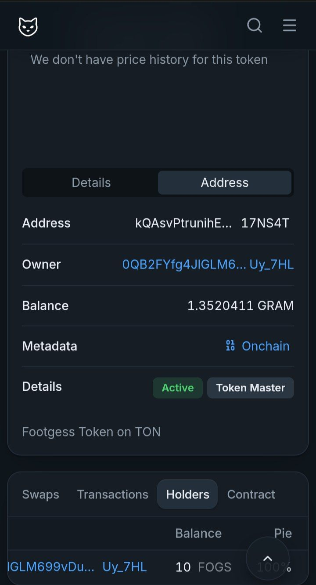

# Footgess (FOGS) - TEP-74 Jetton Token

A fully compliant Jetton token built with Tact language on the TON Blockchain. This project implements the official TEP-74 (Fungible Token Standard) and TEP-89 (Discoverable Jettons) standards, ensuring full compatibility with major TON wallets (Tonkeeper, Telegram Wallet) and DEXs (STON.fi, DeDust).

## :rocket: Live Deployment (Testnet)

- Token Name: Footgess
- Symbol: FOGS
- Total Supply: 10 FOGS (Minted for testing)
- Contract Address (Jetton Minter): EQAsvPtrunihEHCmp42a63dTQEYzscpNxcq4b3oNZB17NZWZ
- Explorer Link: [View on Tonscan (Testnet)](https://testnet.tonscan.org/address/EQAsvPtrunihEHCmp42a63dTQEYzscpNxcq4b3oNZB17NZWZ)

## 🛠 Tech Stack

- Smart Contract Language: Tact
- Development Framework: Blueprint (@ton/blueprint)
- Client Library: @ton/ton & @ton/core
- Cryptography: @ton/crypto
- Network: TON Testnet

## :open_file_folder: Project Structure

- contracts/ - Contains the Tact source files (jetton-minter.tact, jetton-wallet.tact)
- src/output/ - Auto-generated TypeScript wrappers and bindings from Tact compiler
- src/scripts/ - Deployment and interaction scripts (base.deploy.ts, mint.ts)
- src/wrappers/ - Extended TypeScript wrappers for easier contract interaction

## ⚙ How to Deploy & Mint

### 1. Prerequisites
Ensure you have Node.js installed (v18+ recommended), then install dependencies:
`bash
npm install --legacy-peer-deps
